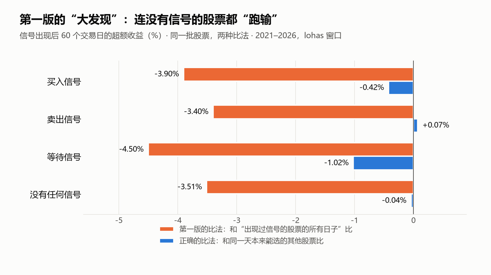
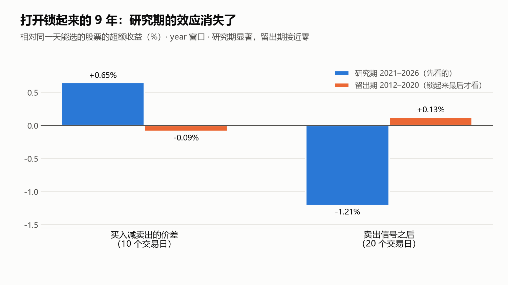
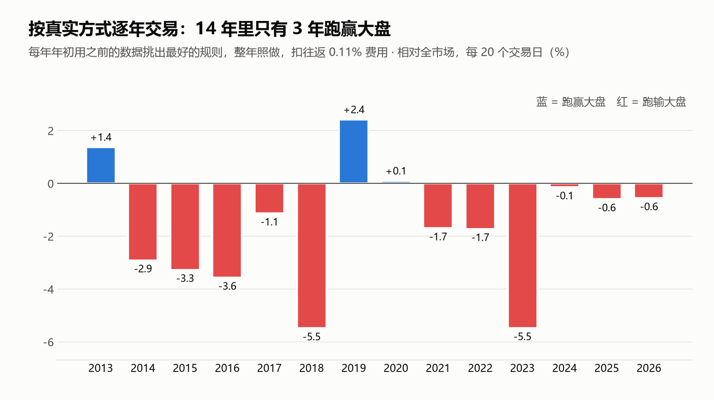

# 五线谱传得很神，我用 5000 多只股票、15 年数据把它测了个底朝天

"跌到下轨就买，涨到上轨就卖。"

如果你在股民群里待过，大概听过五线谱。给一只股票过去几年的价格拟合一条趋势线，上下再画四条线，像五线谱。价格碰到最下面那条，就是"便宜了"；碰到最上面那条，就是"贵了"。

它好懂、好看，截图更好看：一张图上，低点刚好踩在下轨，高点刚好碰到上轨，像被精准预言过一样。

我信过。也照着买过。

**然后亏了。**【这里写你亏了多少、是怎么亏的：哪只股票？跌到下轨买进，结果继续往下跌？】

亏完以后，我做了一件程序员会做的事：**不看截图，看数据。**

---

## 我先给它造了一台"复刻机"

我把五线谱写成了一个网站：每天晚上自动下载全部 A 股的行情，给每只股票画五线谱、算信号，把"买入候选"排在首页。

接下来的问题很简单：**这些信号，在全市场、十几年里，到底灵不灵？**

不是挑几只股票看，是 5000 多只股票，包括已经退市的，2012 到 2026 年，一天不落地算一遍。

## 第一次结果：一个"惊天发现"

第一版程序跑完，结果吓了我一跳：

- 所有信号出现后，股票 60 天平均跑输大盘 **4% 到 5%**；
- **买入信号反而是反向指标**，越提示买，后面越差；
- 统计上的显著性高得离谱：t 值 −35，一般 2 就算显著。

那一刻我挺兴奋：反着做不就行了？

但写了这么多年代码，我太熟悉这种感觉了。**结果越惊人，越可能是 bug。**

## 真相：连"没信号"的股票都跑输

我一项一项查下去，最后发现问题出在"跟谁比"。

第一版拿信号股和"出现过信号的股票的所有日子"比。换成合理的比法，也就是和**同一天、本来也能选的其他股票**比，结果全变了：

看最下面那一行：**一个信号都没有的股票，用第一版的比法也"跑输"了 3.5%。**

所以跑输的根本不是信号，而是五线谱的前提："只做过去几年稳定上涨的股票"。这批股票之后就是会跑输，跟买卖信号无关。换成正确的比法，所有信号都缩到接近零。

那个"惊天发现"，是我自己的 bug。

## 第二次：我把 9 年数据锁进了抽屉

吃过一次亏，第二版我给自己立了几条规矩：

- **先对答案**：研究用的程序和网站上的程序，抽 914 个样本逐个对比，**914 个全部一致**，才往下做。
- **考试前不偷看答案**：2012 到 2020 年的数据先锁起来，只用 2021 年以后的做研究。结论写好、提交到 Git 之后，才打开那 9 年。
- **扣掉运气**：同时测几十种组合，总有几种会"碰巧显著"，就像抛硬币抛得够多，总能连出五个正面。所以要做多重检验校正。

研究期确实还剩一点东西：卖出信号之后，股票 20 天平均跑输 1.2%，统计上站得住。

然后我打开了抽屉。

**消失了。**两个效应在那 9 年里都变成了零，卖出信号甚至反过来了。回头再看，研究期那点效应几乎全来自 2022 年和 2024 年两个熊市。那是行情，不是规律。

## 最后一关：假装我是真的在用它交易

前面都是统计。最后我用最贴近真实的方式测了一遍：

每年年初，只用**之前的**数据，挑出扣费后表现最好的用法，然后整年照着做，手续费照扣，年底和大盘比。

**14 年里，只有 3 年跑赢大盘。**而且每年挑出来的"最好用法"都在变：去年最好的，今年往往最差。

这就是我亏钱的原因：不是我用错了，而是它本来就不行。那些"精准"的截图，只是在几千只股票里挑出了刚好说中的那几只。

## 为什么它不行

1. **它用的是全世界最便宜的信息。**过去的收盘价，所有人都看得到，同一条线谁都画得出来。真有一个人人都能用的稳定赚钱方法，早被大资金做没了。
2. **它押的是"会回到趋势线"。**可 A 股有时候跌了还会继续跌，有时候才反弹，你没法提前知道今年是哪一种。
3. **它的前提就吃亏。**只挑过去几年涨得最好的股票，而这批股票之后往往跑输大盘。

## 不服气，又测了一圈

管道都搭好了，我按同样的规矩，又把几个流行的方法测了一遍：

- **均线金叉**：金叉之后反而跑输。金叉一定出现在刚涨完一段之后，而 A 股刚涨完的股票，接下来往往会回吐。
- **买低波动的股票**：没优势。但反过来，**最近一个月波动最大的 10% 股票，15 年里 13 年跑输**。这是我测到最稳的一条，可惜只能告诉你别碰什么。
- **买便宜股、买高 ROE、买业绩超预期**：用当时真实公布的财报，事先写下 14 条说法，**一条都没成立**。

## 给我的网站挂上牌子

研究做完，我在自己网站每一个信号页面的最上面，加了一行红字：

> **已检验：这些信号无效。**

然后把公开网址停掉了。

现在我的钱大部分放存款和国债，小部分每月定投宽基指数基金，一年调一次比例，平时不看盘。很无聊，但我用同样的方法回测过：股债分散的组合，2014 到 2026 年年化 7.3%，最大跌幅 27%；全仓沪深300 年化 6.8%，最大跌幅 45%。

## 如果你也在用五线谱

不是说你一定会亏，而是：**你看到的那些截图，证明不了任何事。**

想知道一个方法灵不灵，至少问这三个问题：

1. 它跟谁比？和"同一天能买的其他股票"比过吗？
2. 有没有一段数据，是在定下规则之后才拿来检验的？
3. 扣掉手续费、按真实买卖的方式做，还能跑赢大盘吗？

能过这三关的方法，我还没见过。

---

全部代码和每一份研究报告都公开在 GitHub：[red-mine/stockstave](https://github.com/red-mine/stockstave)。文中每个数字都能重新算出来，欢迎来挑错。

*个人研究记录，不构成投资建议。*
